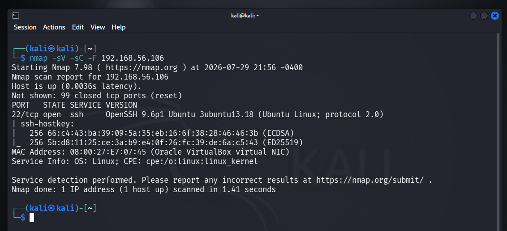

[← Back to Index](./README.md) | Next: [Exploitation →](./02-exploitation.md)

# Phase 1 — Lab Setup & Reconnaissance

## 1.1 Environment & Topology

| Role | Hostname | IP | OS / Software |
|---|---|---|---|
| Attacker | kali-linux-2025.4-virtualbox-amd64 | `192.168.56.102` | Kali Linux 2025.4 (Nmap, Hydra) |
| Victim (Endpoint) | endpoint-linux-waz-plunk | `192.168.56.106` | Ubuntu 24.04.4 LTS, Wazuh Agent v4.14.6 |
| Monitoring (Manager) | wazuh-server | `192.168.56.104` | Wazuh v4.14.6 (Manager, Indexer, Dashboard) |

Network configuration: **Host-Only Adapter** (inter-VM communication, isolated from external network) combined with **NAT** (per-VM internet access for updates).

```
[Kali Linux - Attacker]  --(SSH brute force)-->  [Endpoint Linux - Victim]
192.168.56.102                                    192.168.56.106
                                                        |
                                                  (Wazuh Agent)
                                                        |
                                                        v
                                             [Wazuh Server/Manager]
                                             192.168.56.104
```

This lab was originally built in a prior project session (~July 2026) and reactivated for this incident response exercise after approximately two months of inactivity — a detail that becomes significant in [Phase 4](./04-root-cause-and-remediation.md).

### Project folder structure


### Lab baseline verification (VMs running)


### Wazuh agent status (pre-attack baseline)


Agent `endpoint-linux-wazuh` (IP `192.168.56.106`) confirmed **active** prior to any simulated attack activity, running Ubuntu 24.04.4 LTS.

---

## 1.2 Reconnaissance

**Objective:** identify the attack surface on the victim host before launching any exploitation attempt.

**Command:**
```bash
nmap -sV -sC -F 192.168.56.106
```

| Flag | Purpose |
|---|---|
| `-sV` | Service/version detection |
| `-sC` | Run default Nmap scripting engine scripts |
| `-F` | Fast scan — top 100 most common ports |

**Result:**

```
PORT   STATE SERVICE VERSION
22/tcp open  ssh     OpenSSH 9.6p1 Ubuntu 3ubuntu13.18 (Ubuntu Linux; protocol 2.0)
```

Only port 22/tcp (SSH) was found open — the single attack surface on this host. This directly informed the decision to pursue SSH credential brute forcing as the attack vector for this scenario.



---

[← Back to Index](./README.md) | Next: [Exploitation →](./02-exploitation.md)
