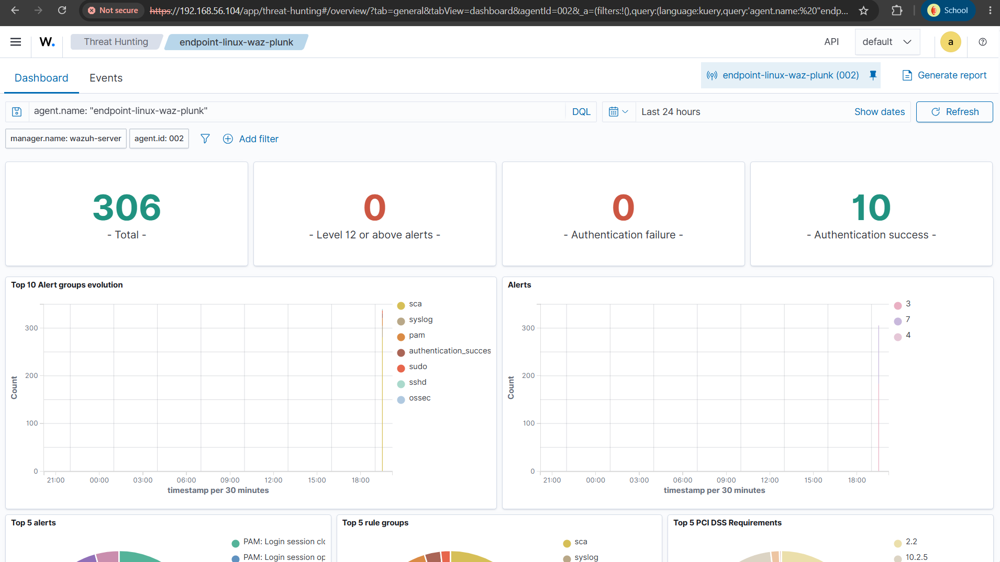
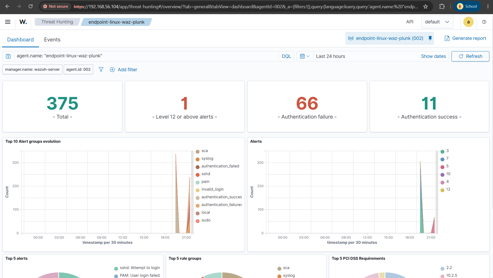
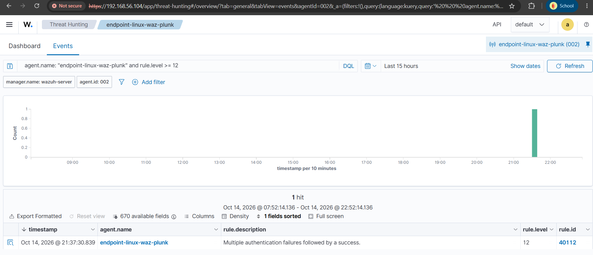
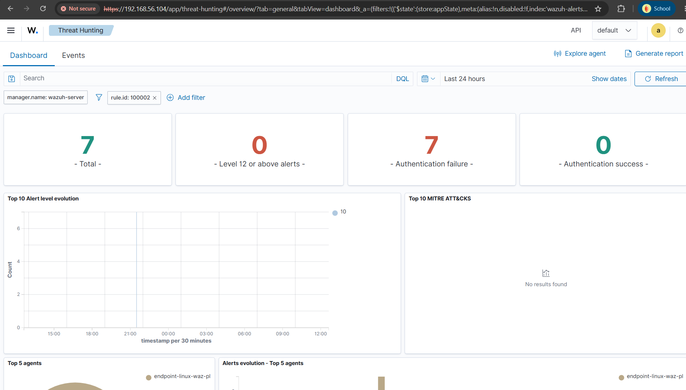

[← Previous: Exploitation](./02-exploitation.md) | [Back to Index](./README.md) | Next: [Root Cause & Remediation →](./04-root-cause-and-remediation.md)

# Phase 3 — Detection & Analysis

## 3.1 Baseline (Pre-Attack)

Before launching the attack, the Wazuh dashboard was checked to confirm a clean baseline — no pre-existing brute force alerts that could contaminate the results.

**Baseline metrics:** 0 authentication failures, 10 authentication successes, 0 alerts at level 12+.

---

## 3.2 Post-Attack Dashboard

After the brute force attack completed:

**Metrics:** Authentication failures increased from 0 → 66. Authentication successes increased from 10 → 11 (the one successful login via Hydra). One alert at level 12+ was recorded.

---

## 3.3 Detection Rule Analysis

Two separate rules were identified as having triggered during this attack, each covering a different aspect of the attack pattern.

### Rule 40112 — Built-in correlation rule (fail → success)

| Field | Value |
|---|---|
| Rule ID | `40112` |
| Level | `12` |
| Description | *"Multiple authentication failures followed by a success."* |
| Type | Wazuh built-in |

This rule correctly identified the core attack pattern: multiple failed logins on the valid account, followed by a successful authentication — a strong indicator of a compromised credential, as opposed to a legitimate user mistyping their password once or twice.

### Rule 100002 — Custom rule (non-existent user)

| Field | Value |
|---|---|
| Rule ID | `100002` |
| Level | `10` |
| Description | *"SSH brute force attempt: multiple non-existent user login failures detected."* |
| Condition | 5 failures within 120 seconds, matched against `sid 5710` |
| Type | Custom (pre-existing, from prior lab session) |

This rule triggered 7 times from the failed attempts against the non-existent usernames (`root`, `admin`, `user`, `test`) that Hydra continued to attempt after the successful login.

### Detection Gap Identified

The custom rule 100002 is scoped exclusively to failures against **non-existent** usernames (`if_matched_sid: 5710`). It does **not** count failed attempts against **valid** usernames. This means a brute force attack targeting only a known-valid account (without mixing in non-existent usernames) would **not** trigger rule 100002 at all, and by extension would not trigger its associated active response.

In this incident, the built-in rule 40112 happened to provide detection coverage for that exact gap — but this was effectively incidental, not a deliberate defense-in-depth design. This is flagged as a finding for future rule tuning (see [Lessons Learned](./04-root-cause-and-remediation.md#lessons-learned)).

---

[← Previous: Exploitation](./02-exploitation.md) | [Back to Index](./README.md) | Next: [Root Cause & Remediation →](./04-root-cause-and-remediation.md)
