[← Previous: Detection & Analysis](./03-detection-and-analysis.md) | [Back to Index](./README.md)

# Phase 4 — Root Cause Analysis, Containment & Remediation

## 4.1 Problem Statement

Despite both detection rules (40112 and 100002) triggering correctly (see [Phase 3](./03-detection-and-analysis.md)), the automated containment action associated with rule 100002 — an active response configured to drop the attacker's IP via `firewall-drop` — **did not execute**. The attacker's IP remained fully reachable after the attack, and no new entries appeared in `active-responses.log` on the endpoint.

```xml
<active-response>
    <disabled>no</disabled>
    <command>firewall-drop</command>
    <location>defined-agent</location>
    <agent_id>001</agent_id>
    <rules_id>100002</rules_id>
    <timeout>600</timeout>
</active-response>
```

This section documents the step-by-step investigation that uncovered **three compounding issues**, all ultimately traceable to the lab having been idle for approximately two months before this exercise.

---

## 4.2 Investigation Steps & Findings

### Finding 1 — `wazuh-manager` service in a failed state

**Check:**
```bash
sudo systemctl status wazuh-manager
```
**Result:** `Active: failed (Result: timeout)` — despite several sub-processes still visibly running under the old cgroup, the manager service itself had failed to (re)start cleanly, likely due to leftover processes from before the two-month idle period not shutting down properly.

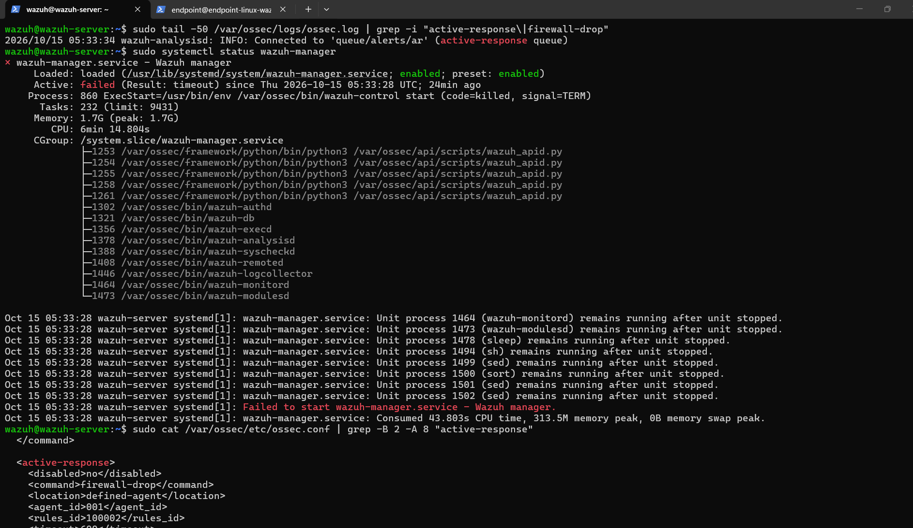

**Remediation attempt 1 — standard restart:**
```bash
sudo systemctl restart wazuh-manager
```
This brought the service to `active (running)`, but log output showed all sub-processes as *"already running"* rather than freshly started — indicating this was a status re-sync rather than a true clean restart.

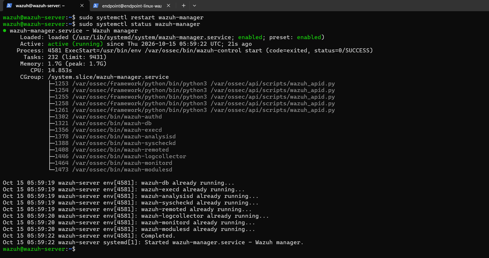

**Remediation attempt 2 — forced clean restart:**
```bash
sudo systemctl stop wazuh-manager
sudo pkill -9 -f wazuh
sleep 3
sudo systemctl start wazuh-manager
sudo systemctl status wazuh-manager
```
This produced a genuinely fresh set of processes (new PIDs, log lines showing *"Started wazuh-execd..."* etc. instead of *"already running"*).

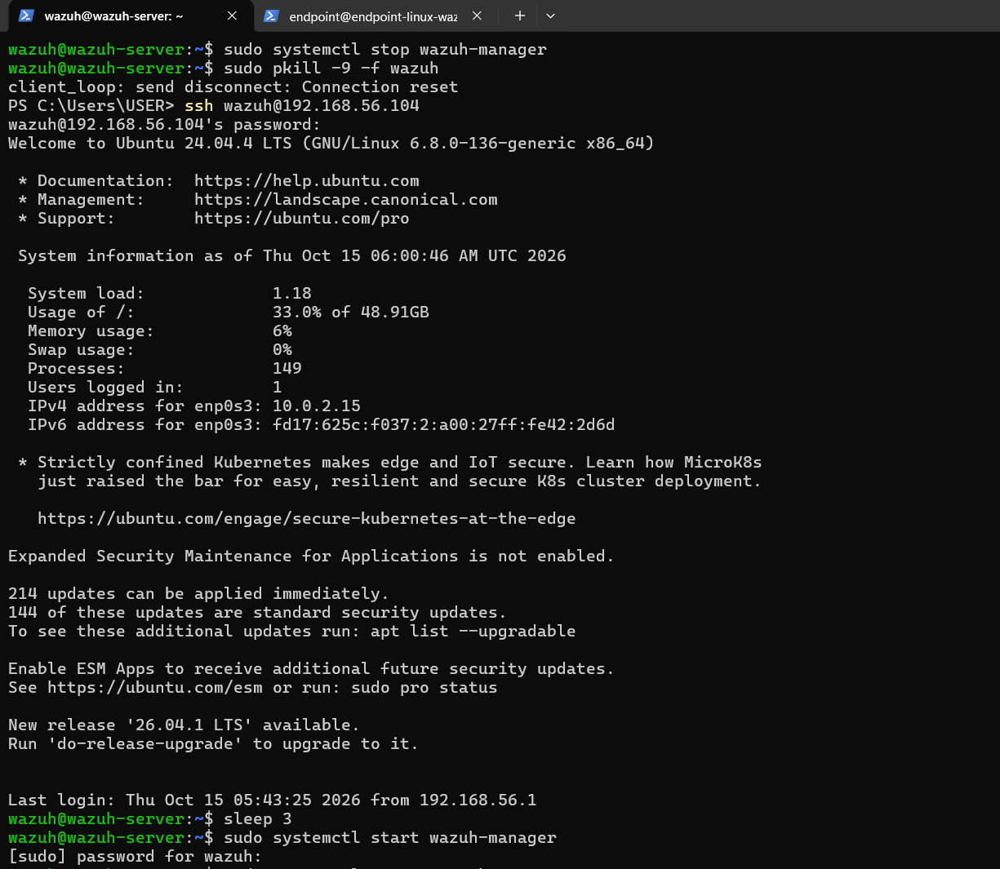
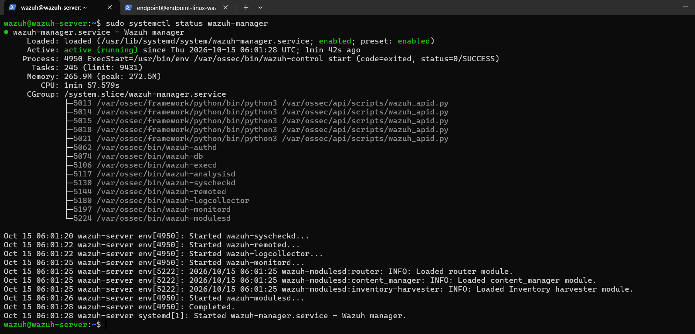

### Finding 2 — `wazuh-indexer` killed as collateral damage

**Check:**
```bash
sudo systemctl status wazuh-indexer
```
**Result:** `Active: failed (Result: signal)`, `code=killed, signal=KILL` — the indexer (OpenSearch/Java-based backend powering the dashboard and alert storage) had been terminated. `dmesg` was checked for an OOM kill event, but none was found — confirming this was very likely **collateral damage** from the `pkill -9 -f wazuh` command used in Finding 1, which matches *any* process with "wazuh" in its command line, including the independent indexer service, not just the manager's own sub-processes.

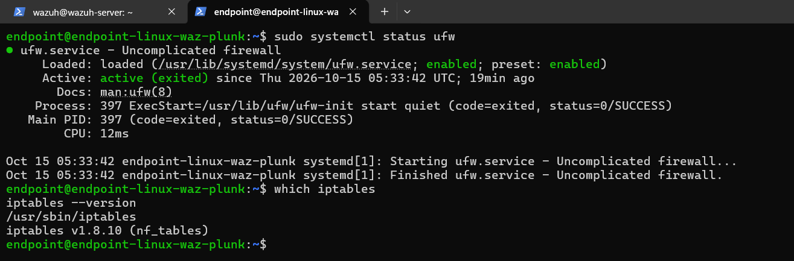

**Remediation:**
```bash
sudo systemctl restart wazuh-indexer
```
Indexer returned to `active (running)` with a new PID.

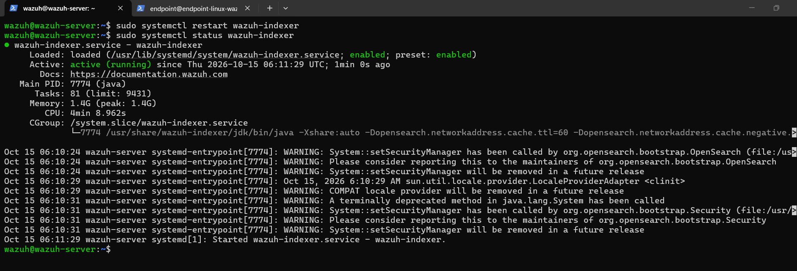

### Finding 3 — Agent ID mismatch (root cause)

With both the manager and indexer confirmed healthy, the attack was re-run — but the IP was still not blocked, and the manager's log (`ossec.log`) showed no active-response activity at all for the new attack, even though the dashboard confirmed rule `100002` was still triggering.

**Check — registered agents:**
```bash
sudo /var/ossec/bin/agent_control -lc
```
```
ID: 000, Name: wazuh-server (server), IP: 127.0.0.1, Active/Local
ID: 002, Name: endpoint-linux-waz-plunk, IP: any, Active
```

**Root cause:** the active-response configuration in `ossec.conf` targeted `<agent_id>001</agent_id>`, but the actual registered agent now has **ID 002**. Historical log analysis (`ossec.log`) confirmed the hostname of the endpoint had changed between the original lab build (`endpoint-linux-wazuh`, enrolled July 2026 as agent `001`) and this session (`endpoint-linux-waz-plunk`, re-enrolled October 2026 as agent `002`). Because Wazuh treats a changed hostname as a new agent identity, it issued a new agent ID — and the active-response configuration, still pointing at the old ID, was effectively sending its containment command to an agent that no longer matched the one actually under attack.

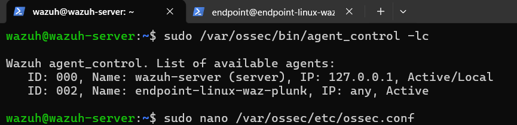

**Remediation:**
```bash
sudo nano /var/ossec/etc/ossec.conf
# <agent_id>001</agent_id>  →  <agent_id>002</agent_id>
sudo /var/ossec/bin/wazuh-control restart
```

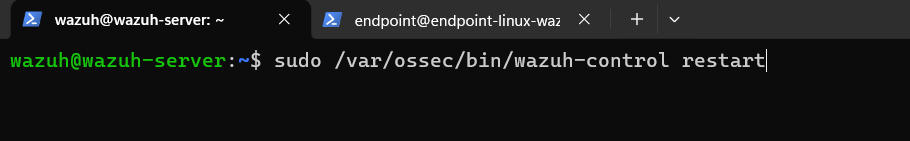

---

## 4.3 Verification — Active Response Re-Test

After the fix, the brute force attack was re-executed to validate the full detection-to-containment chain.

**Network-level verification (attacker side):**
```bash
ping -c 4 192.168.56.106
```
Result: `4 packets transmitted, 0 received, 100% packet loss` — attacker IP confirmed blocked.

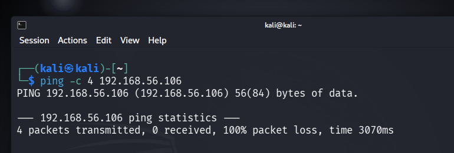

**Firewall-level verification (endpoint side):**
```bash
sudo iptables -L -n | grep 192.168.56.102
```
Result: two `DROP` rules present for the attacker's IP.

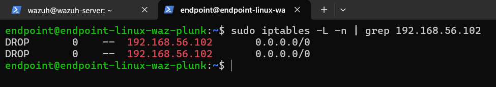

**Application-level verification (`active-responses.log`):**
A new entry appeared with the current timestamp, `agent.id: "002"`, and status `"continue"` (rather than the `"Aborted"` status seen in all historical pre-fix entries) — confirming the command was both correctly targeted and successfully executed.

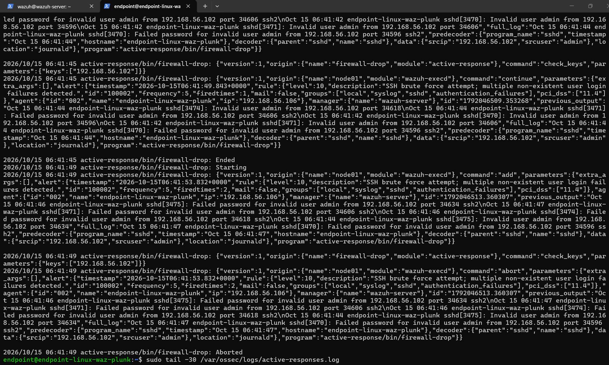

---

## 4.4 Manual Containment — Compromised Account

Beyond the automated IP block, manual containment was performed on the compromised account (`endpoint`) itself, following standard incident response practice: verify active sessions → terminate any attacker sessions → reset credentials → audit for further activity.

### Step 1 — Identify active sessions

```bash
who
w
```
An active SSH session from the attacker's IP (`192.168.56.102`, tty `pts/1`) was identified alongside the legitimate analyst session.


### Step 2 — Terminate the attacker session

```bash
ps aux | grep pts/1
sudo kill -9 4015
```
The parent `sshd` process for the attacker's session was identified and force-killed.

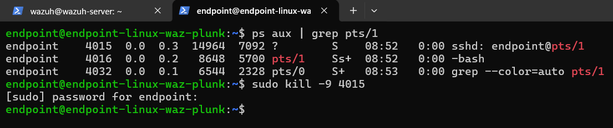

### Step 3 — Verify termination

```bash
who
w
```
Confirmed only the legitimate analyst session remained.

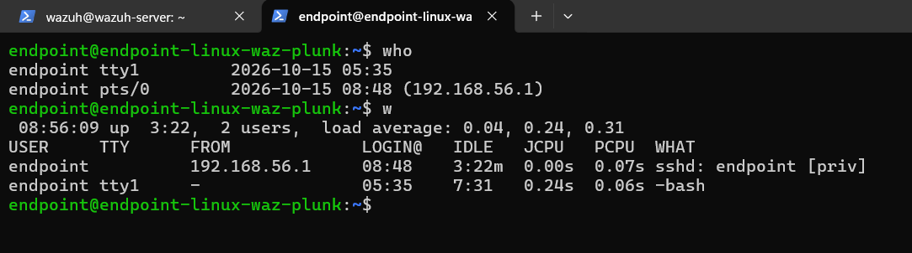

### Step 4 — Reset compromised credentials

```bash
sudo passwd endpoint
```
Password updated successfully.

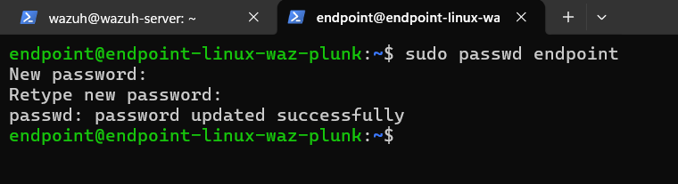

---

## 4.5 Post-Incident Audit

```bash
cat ~/.bash_history
tail -10 ~/.bash_history
```
Commands recorded were limited to reconnaissance-style activity (`cat /etc/passwd`, `whoami`, `id`, `sudo -l`, `sudo -i`) — no destructive or persistence-oriented commands (no new user creation, no cron jobs, no SSH key injection, no binary downloads) were found.

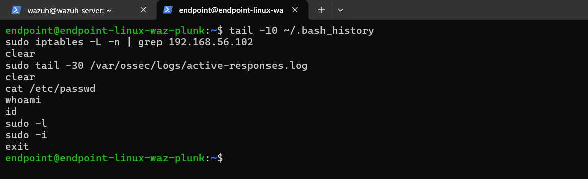

**Limitation identified:** `.bash_history` records *what* was run, but not *who* ran it or *when* at a per-line level — there is no timestamp or session/user attribution per command. In a scenario where an account is shared or accessed by both an attacker and a defending analyst, this makes it difficult to cleanly separate malicious activity from legitimate investigative activity within the same history file.

---

## 4.6 Impact Assessment

- **Confidentiality/Integrity:** One account (`endpoint`) was compromised via weak credential guessing. No evidence of data exfiltration, persistence mechanisms, or lateral movement was found in the post-incident audit.
- **Availability:** No service disruption to the victim host itself. The automated containment response was temporarily non-functional for approximately 2 hours (05:33–06:41) during this exercise, due to the infrastructure issues described in Section 4.2 — a monitoring/response gap, not an attacker-caused outage.
- **Scope:** Limited to a single isolated lab host; no production or external systems were involved.

---

## 4.7 Remediation & Recommendations

**Immediate actions (completed in this exercise):**
- Terminated the attacker's active session on the compromised account.
- Reset the compromised account's password.
- Verified and corrected the active-response `agent_id` mapping.

**Short-term:**
- Audit all other active-response rules in `ossec.conf` for similarly hardcoded `agent_id` values that could silently desync after an agent re-enrollment.
- Add a detection rule (or alert) specifically for **new agent enrollment events**, so that identity changes (e.g., hostname changes) are flagged for review rather than passing silently.
- Extend the custom rule set (or rely more deliberately on built-in correlation rules) to ensure brute force against **valid** usernames is independently detected, not reliant on incidental coverage from a separate rule.

**Long-term:**
- Document a standard "lab/system reactivation checklist" to run after any extended period of inactivity (service health checks, agent connectivity checks, active-response dry-run tests) before relying on the environment for testing.
- Consider enabling more granular audit logging (e.g., `auditd`, `HISTTIMEFORMAT`, or session recording) to address the `.bash_history` attribution gap identified in Section 4.5.
- Avoid broad-pattern process-kill commands (e.g., `pkill -f wazuh`) in operational runbooks; prefer targeted, per-service commands to avoid collateral impact on unrelated services.

---

## Lessons Learned

- A rule scoped narrowly (e.g., "non-existent user" only) can create a detection blind spot for closely related attack variants (e.g., brute force against valid accounts) — relying on incidental coverage from a separate rule is not a substitute for deliberate detection design.
- Infrastructure left idle for an extended period should not be assumed to be in the same operational state as when it was last used — services can silently fail, and this may not be visible until a dependent workflow (like active response) is actually exercised.
- A change in system identity (hostname) can silently break identity-dependent configuration (such as an `agent_id`-targeted active response) without producing any explicit error — the rule still "worked" (triggered), but its downstream action was effectively orphaned.
- Broad process-matching commands used for troubleshooting (e.g., `pkill -9 -f wazuh`) can have unintended collateral effects on unrelated but similarly-named services.
- `.bash_history` alone is an insufficient audit trail for multi-user/shared-account forensic analysis due to the lack of per-command timestamps and user attribution.

---

[← Previous: Detection & Analysis](./03-detection-and-analysis.md) | [Back to Index](./README.md)
